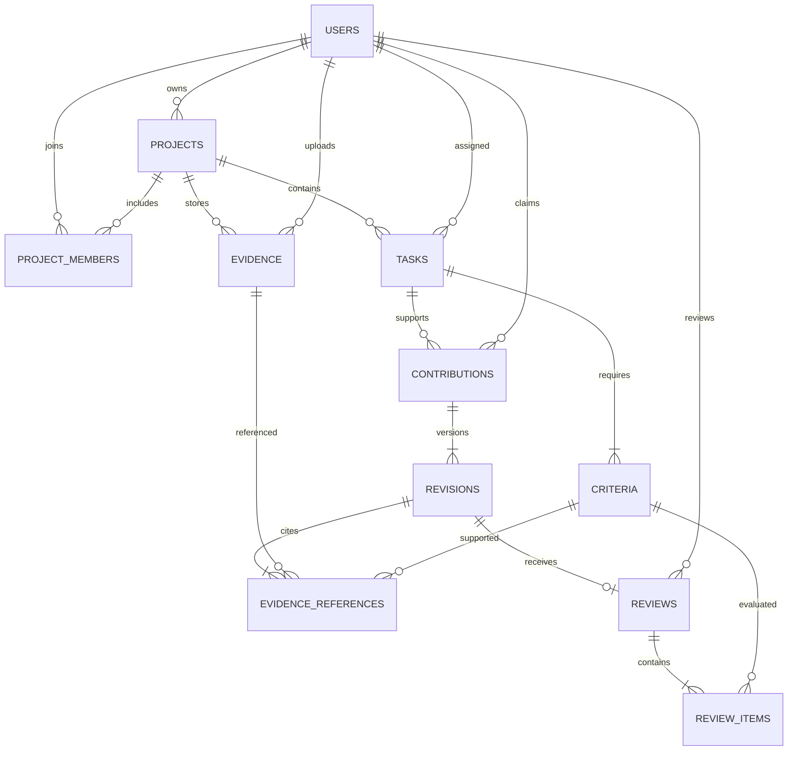
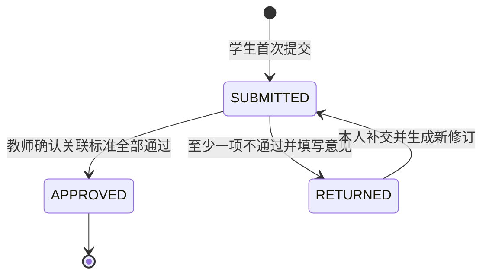

# 数据库与状态设计

第一版用关系型数据库保存项目、材料及验收过程。核心关系是“贡献申报的某个修订，引用某份不可变证据，支持某条任务标准”，验收结果绑定该修订。

## 主要实体

| 表 | 作用 | 关键约束 |
| --- | --- | --- |
| users | 教师和学生身份 | 账号唯一，密码哈希保存 |
| projects | 项目基本信息 | 指定一名指导教师 |
| project_members | 项目成员 | 项目与用户组合唯一 |
| tasks | 工作任务 | 关联项目及一名学生负责人 |
| criteria | 任务验收标准 | 关联任务，发布后不提供编辑入口 |
| evidence | 上传文件或外部链接 | 关联项目及上传者，记录不可覆盖 |
| contributions | 个人贡献申报 | 关联学生、任务及当前版本号 |
| revisions | 每次提交的具体内容 | 同一申报内版本号唯一 |
| evidence_references | 修订的证据引用 | 关联修订、证据、标准，并保存位置及说明 |
| reviews | 该修订的验收结论 | 每个修订最多一条最终验收记录 |
| review_items | 逐项验收意见 | 每次验收中标准编号唯一 |

物理结构以 `backend/src/main/resources/schema.sql` 为准。项目归属、任务归属及引用标准匹配等跨表业务规则在服务层校验。

## 实体关系

## 申报状态

SUBMITTED 在界面显示“待验收”，RETURNED 显示“待补充”，APPROVED 显示“已通过”。第一版填写中的表单不自动保存为服务器草稿。

补交会新增 revisions 和 evidence_references，更新申报的当前版本和状态。旧修订与旧验收不修改。事务与行锁防止并发补交、重复验收及状态竞争。

## 验收含义

教师只验收该次修订引用的标准，服务端要求验收项与引用标准集合一致。每项通过、总结果通过时，该申报成为已确认贡献；这不自动将任务或项目全部标为完成。

同一份团队成果允许多名成员在各自任务中引用，但上传记录不自动分配贡献，引用次数也不计为贡献分数。报告依据申报最新状态展示已确认、待验收与待补充记录，并可查看历史过程。

## 扩展边界

如果后续需要修改已发布标准，应新增标准集版本，并让修订明确引用当时版本；如果需要对同一文件的多个版本分组，应拆分证据主体与证据版本。第一版采用“标准不改、证据新增”的约束保证历史稳定。
